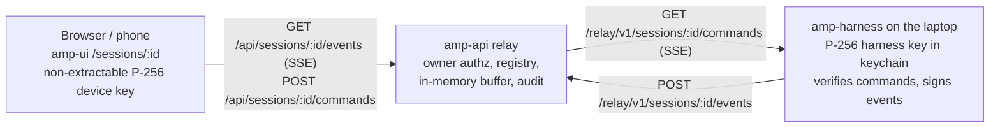
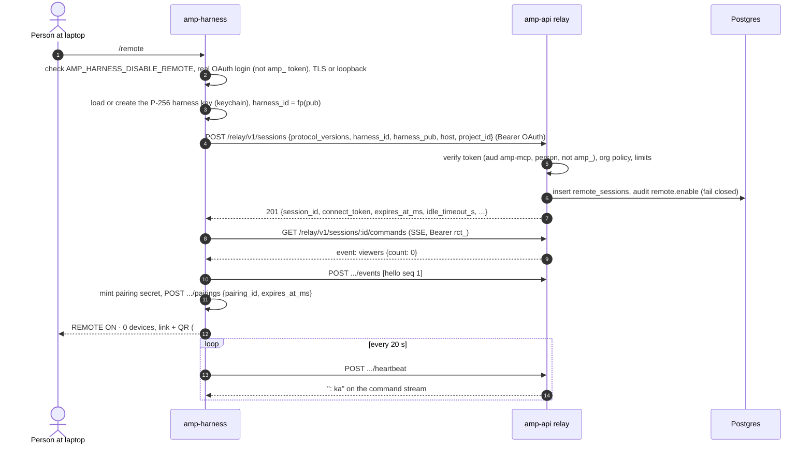
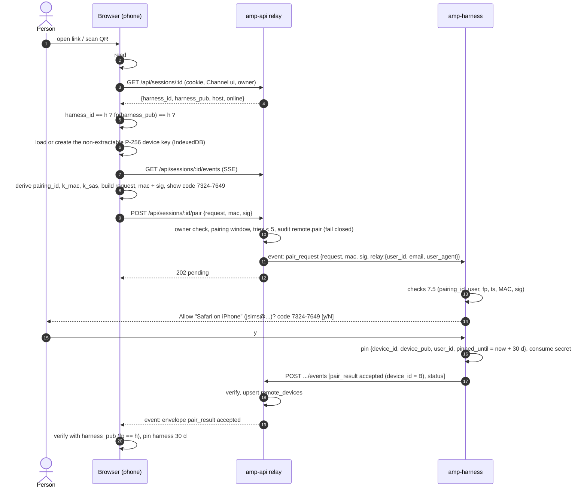
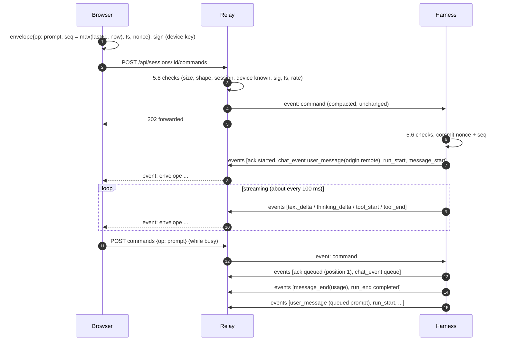
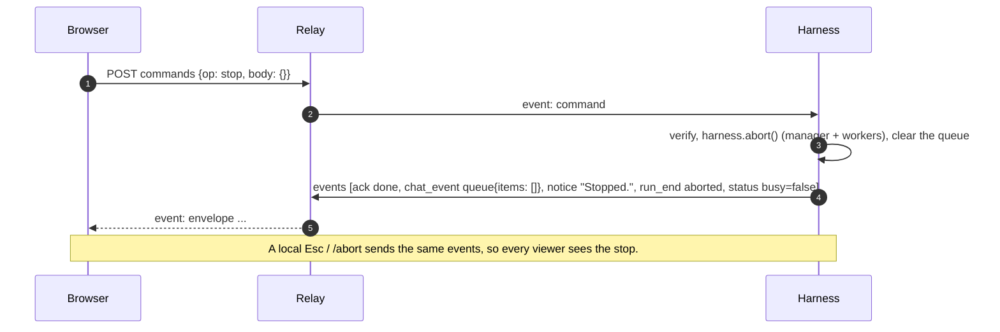
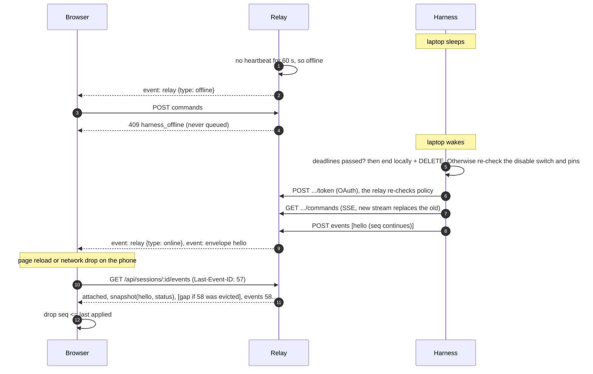
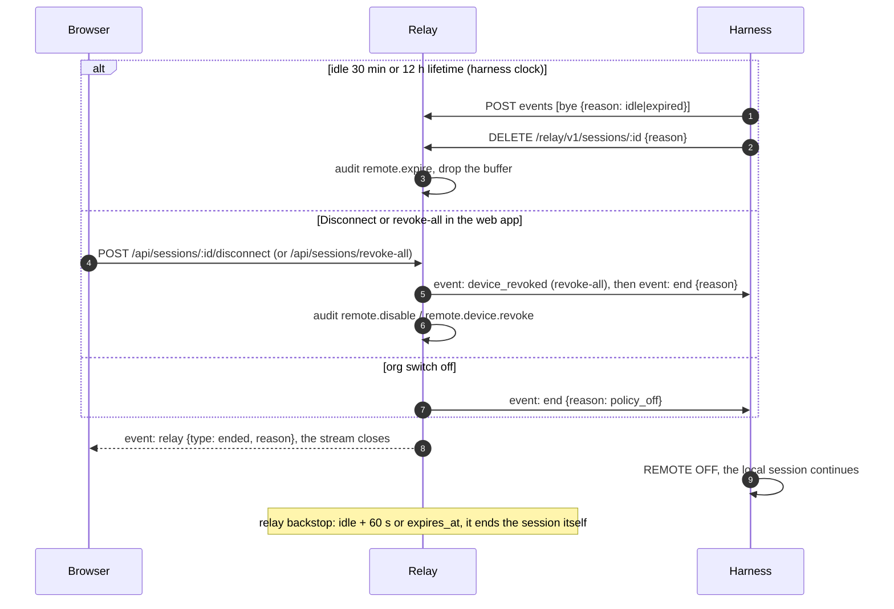

# AMP remote control: wire protocol v1 (M1)

**Status:** contract for milestone M1 (epic 165, story 402). Ticket #2369. Written 2026-10-25.
**Implemented by:** the Rust harness (`v2/harness`), the Go relay inside amp-api (`v2/amp-api`) and the
TypeScript web app (`v2/ui`). All three test suites load the shared vectors in
[`v2/testdata/remote-control/`](../../testdata/remote-control/README.md).

**Design sources:** the KB docs `decisions/harness-remote-control.md` (the design; user decisions D1-D3),
`discoveries/remote-control-threat-model.md` (requirements R-M1..R-M16), `discoveries/remote-control-amp-fit.md`
and `discoveries/remote-control-prior-art.md`. The six open questions in the decision doc take its
recommended answers:

1. A prompt sent while the agent is busy is **queued** as a follow-up and runs when the current run ends.
2. AMP keeps **no transcript**, only an in-memory resync buffer.
3. Only the **owner** can watch or drive a session.
4. Remote control is **off by default** at the org level (and the instance level, `relay.enabled: false`).
5. M1 is chat, Stop, tool calls and status. Questions, workers, model switching and the device list come in M2.
6. Push notifications come later (M3).

The key words MUST, MUST NOT, SHOULD and MAY are used as in RFC 2119. Wherever this document disagrees with
the vectors, the vectors were generated from the reference checks in `gen_vectors.py`, so fix whichever one is
wrong and regenerate. Don't special-case either one.

---

## Contents

1. [Overview](#1-overview)
2. [Identifiers and encodings](#2-identifiers-and-encodings)
3. [Cryptography](#3-cryptography)
4. [The envelope](#4-the-envelope)
5. [Commands (browser to harness)](#5-commands-browser-to-harness)
6. [Events (harness to browser)](#6-events-harness-to-browser)
7. [Pairing](#7-pairing)
8. [HTTP API](#8-http-api)
9. [Error and refusal codes](#9-error-and-refusal-codes)
10. [Limits and timeouts](#10-limits-and-timeouts)
11. [Buffering, resume and presence](#11-buffering-resume-and-presence)
12. [Session lifecycle, policy and audit](#12-session-lifecycle-policy-and-audit)
13. [Versioning and compatibility](#13-versioning-and-compatibility)
14. [Sequence diagrams](#14-sequence-diagrams)
15. [Notes for implementers](#15-notes-for-implementers)
16. [Test vectors](#16-test-vectors)

---

## 1. Overview



- **Transport:** HTTPS only. Server-sent events (SSE) carry streams, and POST carries sends, on both legs.
  There is no WebSocket and no listening socket on the laptop (R-M1).
- **Two legs:**
  - **Harness leg** `/relay/v1/...`: bearer auth. Envoy runs it with ext_authz off, and amp-api verifies the
    token itself, as it does for `/mcp`.
  - **Browser leg** `/api/sessions/...`: the normal oauth2-proxy cookie through Envoy ext_authz. Every call
    requires a person in the web UI (`Channel == ui`).
- **End-to-end authentication, not end-to-end encryption.** The browser signs every command with a key that the
  harness pinned during a pairing confirmed at the laptop. The harness signs every event with its own key, which
  the browser pinned from the pairing link. The relay can read the traffic, because it is TLS only, but it cannot
  forge, change or replay anything.
- **The relay never stores payloads.** Events live only in a bounded in-memory buffer (section 11). Logs and
  audit rows hold metadata only (D3).

## 2. Identifiers and encodings

`b64u` means base64url (RFC 4648 section 5) **without padding**. Decoders MUST reject padding characters and
non-canonical trailing bits. In Go that is `base64.RawURLEncoding.Strict()`; in Rust, the `base64` crate's
`URL_SAFE_NO_PAD`; in TS, a strict decoder (`Uint8Array.fromBase64(s, {alphabet: 'base64url', lastChunkHandling: 'strict'})`
or an equivalent check).

| Name | Format | Example / notes |
|---|---|---|
| `session_id` | `rs_` + b64u(16 random bytes): 25 chars, `^rs_[A-Za-z0-9_-]{22}$` | Minted by the relay at registration. Unguessable, but **not** a bearer secret: authz never relies on it. |
| `harness_id` | Fingerprint of the harness public key (below), 43 chars | Stable for one harness install. |
| `device_id` | Fingerprint of the device (browser) public key, 43 chars | Stable for one browser profile on one AMP origin. |
| Fingerprint | b64u(SHA-256(public key raw bytes)), 43 chars | Self-certifying: a receiver MUST check `fp(pub) == id` wherever it learns a key. |
| Display fingerprint | The first 8 bytes of SHA-256(raw pub), upper-case hex, in groups of 4 joined by `-` | `29CA-E6B5-00C2-66CB` (`harness-1` in `keys.json`). For people only. |
| Public key ("raw") | 65-byte uncompressed SEC1 point `0x04 ‖ X ‖ Y`, carried as b64u (87 chars) | WebCrypto `exportKey('raw')`; Go `ecdsa.ParseUncompressedPublicKey` (Go 1.25+); Rust `p256::PublicKey::from_sec1_bytes`. Compressed points MUST be rejected. |
| `nonce` | b64u(16 random bytes), 22 chars | A CSPRNG for every envelope. |
| `seq` | Integer, 1 ≤ seq ≤ 2^53−1 | Section 5.3 (commands) and 6.1 (events). |
| `ts`, `*_ms` | Integer Unix time in **milliseconds** | |
| `*_s` | Integer seconds | |
| Pairing secret | 32 random bytes, b64u (43 chars) | Lives only in the link fragment and in harness memory. |
| `pairing_id` | b64u(SHA-256(`"amp-rc/1 pairing-id\n"` ‖ secret)[0..16]), 22 chars | Lets the relay count tries without knowing the secret. |
| `connect_token` | `rct_` + b64u(32 random bytes) | Opaque. Stored hashed (SHA-256) by the relay. Never logged; log a prefix only. |
| `prompt_id`, `message_id`, `run_id` | Harness-chosen strings ≤ 64 chars, `^[A-Za-z0-9_-]+$` | For example `p_12`, `msg_7`, `run_3`. |
| `client_msg_id` | Browser-chosen, `^[A-Za-z0-9_-]{1,64}$` | Correlates the UI's optimistic message with its `ack`. |

All JSON is UTF-8. Section 3.3 sets the profile every envelope must follow.

## 3. Cryptography

### 3.1 Algorithms

| Use | Algorithm |
|---|---|
| Signatures, both directions | **ECDSA over P-256 with SHA-256**, `alg: "ES256"`. The signature is IEEE P1363 `r ‖ s` (64 bytes, each half big-endian and left-padded to 32 bytes), carried as b64u (86 chars). It is **not** DER. |
| Fingerprints | SHA-256 |
| Pairing MAC | HMAC-SHA256 with a key from HKDF-SHA256 (RFC 5869) |
| Short authentication string (SAS) | HMAC-SHA256 with a key from HKDF-SHA256, reduced to 8 decimal digits |

**Browser key.** A WebCrypto `{name: "ECDSA", namedCurve: "P-256"}` key pair generated with
`extractable: false` and usages `["sign", "verify"]`. The `CryptoKeyPair` is stored in IndexedDB (structured
clone keeps it non-extractable). One device key per browser profile per AMP origin, reused across sessions and
harnesses. The public key is always exportable: `exportKey('raw', publicKey)` gives the 65 bytes.

**Harness key: also ECDSA P-256.** One key per harness install. The private key is kept in the OS keychain
(the keyring crate the harness already uses for OAuth), as the 32-byte scalar or PKCS#8. The reasons:

1. **The browser must verify harness signatures with WebCrypto.** ECDSA P-256 verification is in every
   WebCrypto implementation the AMP UI targets. Ed25519 in WebCrypto is recent (Chrome 137, Firefox 129,
   Safari 17) and absent on older iOS. A pure-JS fallback would add a dependency to the page whose script
   integrity matters most (T-UI-4).
2. **One algorithm everywhere.** All three codebases implement and test a single signature scheme against a
   single vector set. Go needs nothing beyond the standard library (`crypto/ecdsa`, `crypto/elliptic`).
3. **Forward path to E2E (R-L1).** Optional encryption later is ECDH(P-256) + HKDF + AES-256-GCM over the keys
   both sides already pinned. Both keys must be P-256 for that.
4. **Rust support is mature.** Use the RustCrypto `p256` crate (features `ecdsa`, `sha256`): its
   `ecdsa::Signature` is exactly the 64-byte P1363 form, and it verifies high-S signatures (see 3.4). The `ring`
   and `aws-lc-rs` crates already in the tree through rustls also work (`ECDSA_P256_SHA256_FIXED`). `p256` is
   recommended because it imports a raw scalar from the keychain directly and needs no PKCS#8 wrapper.

### 3.2 Domain-separated signing input

The bytes that are signed are a fixed ASCII prefix followed by the JCS canonical form (section 3.3):

| What | Signing input (bytes) |
|---|---|
| Envelope (command or event) | `"amp-rc/1 envelope\n"` ‖ UTF-8(JCS(envelope **without** the `sig` member)) |
| Pairing request | `"amp-rc/1 pair-request\n"` ‖ UTF-8(JCS(request object)) |

The prefixes end in one LF (0x0A) byte. The signer computes ECDSA-SHA256 over the whole signing input. The
WebCrypto, Go and Rust APIs hash internally, so pass them the signing input, not its hash. Go's `ecdsa.Verify`
takes the hash: `sha256.Sum256(input)`.

Example signing input (from `commands.json`, vector `prompt_valid`, wrapped here for readability):

```
amp-rc/1 envelope
{"alg":"ES256","body":{"client_msg_id":"m-01","text":"run the tests and tell me what fails"},"device_id":"X5Pp2GXb6NEr3Jh05qAy4qnPP9oOBKhSltxS5yIPExs",...,"v":1}
```

### 3.3 Canonical JSON: RFC 8785 (JCS) under the protocol's I-JSON profile

Signatures cover **JCS of the parsed value, never the received bytes.** A receiver parses the wire text,
removes `sig`, canonicalizes and verifies. Every envelope, and every pairing request, MUST satisfy this profile.
A receiver that finds a violation answers `malformed`.

- **Numbers are integers only**, with |n| ≤ 2^53−1. A number token with a fraction or an exponent (`1.0`,
  `1e3`) is malformed, and so are `NaN` and `Infinity`. **So no floats appear anywhere in signed content.**
  Money is an integer count of micro-USD (`cost_usd_micros`), percentages are integers, and arbitrary JSON from
  the model (tool arguments) travels as a **string** (`arguments_json`).
- **No duplicate object keys.**
- **No lone surrogates** in strings or keys.
- **JCS output.** No whitespace. Object members are sorted by their keys' **UTF-16 code units** (not code
  points; the `jcs.json` vector proves the difference). Strings are escaped exactly as ECMAScript's
  `JSON.stringify` escapes them: `\"`, `\\`, `\b`, `\f`, `\n`, `\r`, `\t`, other code points below U+0020 as
  `\u00XX` with **lower-case** hex, and everything else (including U+007F, U+2028, U+2029 and non-ASCII) as raw
  UTF-8. Integers are written in plain decimal.

Per language:

- **TS:** `JSON.parse`, then a recursive canonicalizer: `Object.keys(o).sort()` (the default JS sort is by
  UTF-16 code units, which is exactly right), `JSON.stringify` for strings, and `Number.isSafeInteger` for every
  number. `JSON.parse` can't see duplicate keys or tell `1.0` from `1`. That is acceptable only on the browser,
  which verifies harness events: the harness never emits either, and a relay that injects them changes nothing,
  because each side verifies and uses the same parsed value. The browser MUST still reject non-safe-integer
  numbers and lone surrogates.
- **Go:** **not `encoding/json`.** It escapes U+2028/U+2029 (and `<`, `>`, `&` unless told otherwise), so its
  output is not JCS. Use a JCS library (for example `github.com/gowebpki/jcs`), or write a canonicalizer over a
  `json.Decoder` with `UseNumber()`, rejecting duplicate keys and any `json.Number` containing `.`, `e` or `E`.
- **Rust:** `serde_jcs` over a `serde_json::Value`, or a small canonicalizer. Parse with a duplicate-key check
  (derive structs with `#[serde(deny_unknown_fields)]`, which also rejects duplicate fields) and reject
  `Number::is_f64()`.

### 3.4 Verification rules

- Verify with the public key that is **pinned** for the claimed id: the device pins the harness holds (section 7.7),
  or the harness pin the browser holds. Never verify with a key that came from the relay, except when the key's
  fingerprint equals an id the receiver already trusts.
- A signature that doesn't decode to exactly 64 bytes, or with r or s outside [1, n−1], is `bad_signature`.
- **Accept high-S signatures.** WebCrypto doesn't normalize s, so about half of browser signatures have s > n/2.
  A verifier MUST NOT require low-S. (RustCrypto's `k256` normalizes; `p256` does not. Don't copy secp256k1
  habits.) Replay protection never depends on signature uniqueness: it is `seq` plus `nonce`.
- Sign with a random or hedged nonce in production (WebCrypto always does). The vectors use RFC 6979 only so
  that they are reproducible.

## 4. The envelope

Every command and every event is one JSON object with **exactly** these 11 members. A missing or extra
top-level member makes it `malformed`.

| Field | Type | Command (browser → harness) | Event (harness → browser) |
|---|---|---|---|
| `v` | integer | `1` | `1` |
| `alg` | string | `"ES256"` | `"ES256"` |
| `session_id` | string | The target session | The source session |
| `harness_id` | string | The pinned harness's fingerprint | The signing harness's fingerprint |
| `device_id` | string or null | The signing device's fingerprint | `null` for broadcast events. For `ack`, `refused` and `pair_result`, the `device_id` the result is for. |
| `seq` | integer | Section 5.3 | Section 6.1 |
| `ts` | integer, ms | The sender's clock when signing | The sender's clock when signing |
| `nonce` | string | 16 random bytes, b64u | 16 random bytes, b64u |
| `op` | string | `prompt`, `stop`, `detach` (section 5.1) | `hello`, `status`, `chat_event`, `ack`, `refused`, `pair_result`, `bye` (section 6.2) |
| `body` | object | Per op, **unknown fields refused** | Per op, **unknown fields ignored** |
| `sig` | string | Signed by the device key | Signed by the harness key |

Example (a prompt as the wire may carry it; member order on the wire doesn't matter):

```json
{
  "v": 1, "alg": "ES256",
  "session_id": "rs_YIL0d-r7J-AHLPpZ00o2bA",
  "harness_id": "KcrmtQDCZstbc69koLwXJWQvwvQbZAufZBMxCffV6DY",
  "device_id": "X5Pp2GXb6NEr3Jh05qAy4qnPP9oOBKhSltxS5yIPExs",
  "seq": 1792948798500, "ts": 1792948798500, "nonce": "dPTjCr8zMqrmOeC3G1VLhA",
  "op": "prompt",
  "body": {"text": "run the tests and tell me what fails", "client_msg_id": "m-01"},
  "sig": "<86 chars>"
}
```

## 5. Commands (browser to harness)

### 5.1 The M1 allowlist (closed)

| `op` | `body` (exactly these members) | Harness action | `ack.result` |
|---|---|---|---|
| `prompt` | `text`: string, 1..49152 UTF-8 bytes, not whitespace-only. `client_msg_id`: string per section 2. | **Idle:** starts a run with `text` as the user turn. **Busy:** appends it to the follow-up queue (section 5.4). The text is **always literal**: a leading `/` is never a slash command (R-M6, T-H-2). The harness tags the turn `[remote: <device name>]` in its local transcript and in the model context (R-M16). | `started` or `queued` |
| `stop` | `{}` | Aborts the running turn and its workers, as Esc / `/abort` do, and **clears the follow-up queue**. Always allowed while the session is live, never rate limited below 120/min. | `done` |
| `detach` | `{}` | Ends remote control for this session, as `/remote off` does. The local session keeps running. The harness sends `bye {reason: "detached"}` and `DELETE`s the relay session. | `done` |

**Reserved names.** A v1 M1 harness MUST refuse these with `unknown_op`. They are listed so that nobody reuses
them with another meaning: `stop_worker`, `answer`, `set_model`, `cancel_queued` (M2); `approve_tool` (only if
an ask path ever exists, R-S9). Anything not in the table above is refused with `unknown_op`. That includes every
local-only action: config, providers and keys, MCP and repo trust, `/server`, `/open`, pairing, timeouts,
policy and plan approval.

A harness that supports more ops later advertises them in `hello.body.ops` (section 6.3). A browser MUST NOT send
an op that the session's latest `hello.ops` doesn't list.

### 5.2 Command results

The relay's `202` only means "forwarded". The harness's verdict arrives on the event stream as an `ack` or a
`refused` event whose `body.ref` is `{device_id, seq}` of the command. The UI SHOULD show "no answer from the
laptop" if neither arrives within 10 s.

### 5.3 `seq` for commands

- The scope is per `(session_id, device_id)`. The harness keeps `last_seq[device_id]` for the session, starting at 0.
- A command is accepted only if `seq > last_seq`. After a successful signature, ts and nonce check, the harness
  sets `last_seq = seq` and records the nonce **before** the op and body checks (section 5.6, step 11). A command
  refused for `unknown_op` or `invalid_body` can therefore never be replayed either.
- **Browser rule:** `seq = max(last_sent + 1, Date.now())`. Clock-based values survive page reloads without
  storage. With several tabs on one device, a collision makes the harness answer `refused {code:
  "seq_not_increasing", last_seq}`. The tab may then re-sign **once** with `seq = last_seq + 1`, a fresh nonce
  and a fresh `ts`. That is a new command, not a replay.

### 5.4 Follow-up queue (open question 1)

- The harness keeps at most **5** queued prompts per session. A 6th is refused with `queue_full`.
- Queued prompts run in order, each as a new run, when the current run ends with any outcome other than one
  caused by `stop`.
- `stop` (remote or local Esc / `/abort`) clears the queue.
- Every change sends a `chat_event` of type `queue` (section 6.4), so every viewer can show "queued (2)".
- A queued prompt is announced as `user_message` only when it starts, so the transcript order is the order of
  execution.
- Typing on the laptop while a run is busy keeps today's TUI behaviour in M1. The queue is for remote prompts.

### 5.5 Nonce cache and timestamps

- **Command `ts` window:** |ts − now| ≤ 60 000 ms, measured with the receiver's clock, inclusive.
- The harness keeps every nonce it has accepted for the session for at least **120 s** (twice the window), with
  room for at least 10 000 entries. A nonce older than 120 s may be evicted, because its `ts` can't pass the
  window any more.
- The relay MAY keep its own nonce cache. The harness's cache is the one that matters.

### 5.6 Harness command check (normative order)

Exactly one refusal code results, the first check that fails. The vectors in `commands.json` depend on this order.

1. Size of the received text > 65 536 bytes → `too_large`
2. Not a JSON object under section 3.3, or not exactly the 11 envelope members with the right types → `malformed`
3. `v != 1` → `unsupported_version`
4. `alg != "ES256"` → `unsupported_alg`
5. `session_id` isn't this session → `wrong_session`
6. `harness_id` isn't this harness → `wrong_harness`
7. `device_id` isn't pinned, or its pin belongs to another AMP user → `unknown_device`
8. The pin has expired (`pinned_until_ms <= now`) → `device_expired`
9. The signature fails, using the pinned key → `bad_signature`
10. |ts − now| > 60 000 → `stale_ts`
11. The nonce is in the cache → `replayed_nonce`. Then `seq <= last_seq[device_id]` → `seq_not_increasing`.
    **Then commit:** record the nonce and set `last_seq`.
12. `op` isn't on the allowlist → `unknown_op`
13. `body` doesn't match the op's schema exactly → `invalid_body`
14. The rate limit is exceeded (section 10) → `rate_limited`; a full queue → `queue_full`
15. Accept: act, then send an `ack`.

For codes from step 2 onwards, the harness sends a `refused` event when it could parse `device_id` and `seq`
(`ref` is null otherwise). It writes a local log line with no payload. It MAY rate-limit `refused` events to
one per second per device.

### 5.7 Browser event check (normative order)

1. Size > 1 048 576 bytes → `too_large`
2. Malformed under section 3.3 or the envelope shape → `malformed`
3. `v != 1` → `unsupported_version`. The UI shows "This laptop runs a newer harness; update AMP" and stops
   applying events.
4. `alg != "ES256"` → `unsupported_alg`
5. `session_id` isn't the session being viewed → `wrong_session`
6. `harness_id` isn't the pinned harness's id → `wrong_harness`
7. The signature fails with the pinned harness key → `bad_signature`
8. `seq <= last_applied_seq` → `duplicate`: drop it **silently** (this is normal after a reconnect)
9. Unknown `op` → `ignored_unknown_op`: advance `last_applied_seq` but don't render
10. Apply the event, and set `last_applied_seq = seq`

**Events have no `ts` window and no nonce check.** A reconnect can legitimately replay buffered events up to
10 minutes old. Replay is prevented by the `session_id` binding and `seq`. Snapshot frames (section 8.4,
`event: snapshot`) go through steps 1-7 only and **don't** move `last_applied_seq`.

A rejection at steps 2-7 is a security event: the UI shows a red "Untrusted data from the relay was dropped"
notice and never renders the payload.

### 5.8 Relay checks on `POST /api/sessions/:id/commands`

The relay is not trusted, but it filters early so that junk never reaches the laptop and refusals get audited.
It MUST check steps 1-10 of section 5.6, using the device keys it learned from `pair_result` events (section 7.6).
It MUST NOT change the command. It forwards the received bytes after `json.Compact` (whitespace removed,
everything else byte-identical) as one SSE `data:` line. It doesn't check `seq` or `nonce`, and it doesn't check
the op body beyond the size limits and the per-op rate limits.

## 6. Events (harness to browser)

### 6.1 `seq` for events

- The scope is per session. The first event is `seq = 1`, and each event is exactly the previous seq + 1. The
  harness keeps the counter in memory across reconnects for the session's whole life.
- The relay requires contiguity (section 8.3): a gap gets `409 seq_gap`. A batch that starts at or below the
  relay's `accepted_through` is a retry: the relay skips those envelopes and takes the rest.
- Deltas are **not** snapshots. Unlike `WorkerFeed`, events on the wire are never replaced or renumbered: the
  harness coalesces text and thinking deltas for about 100 ms **before** assigning a seq.

### 6.2 Event ops

| `op` | `device_id` | `body` | When |
|---|---|---|---|
| `hello` | null | Section 6.3 | On every connection of the commands stream (first connect and reconnect) |
| `status` | null | The `status` object of section 6.3 | When the status changes, no more than once a second, and at least every 60 s |
| `chat_event` | null | A ChatEvent (section 6.4) | Transcript activity |
| `ack` | The command's device | `{ref: {device_id, seq}, op, result: "started"\|"queued"\|"done", prompt_id: string\|null, queue_position: integer\|null}` | A command was accepted |
| `refused` | The command's device, or null | `{ref: {device_id, seq}\|null, op: string\|null, code, message, last_seq: integer\|null}` | A command was refused (codes in 9.2) |
| `pair_result` | The requesting device | `{pairing_id, result: "accepted"\|"rejected"\|"failed"\|"expired"\|"locked", code: string\|null, tries_left: integer\|null, pinned_until_ms: integer\|null}` | Section 7.5 |
| `bye` | null | `{reason}`. The reasons are in section 12.2. | The harness is ending remote control |

**Field presence in event bodies.** Every member listed is always present. A member typed `X|null` is `null`
when it doesn't apply (never omitted). This keeps the JCS form identical across serde, Go structs and TS. A
browser MUST ignore body members it doesn't know, because later v1 harnesses may add them.

`refused.message` is a short English sentence for people (≤ 200 chars) and never echoes command content.

### 6.3 `hello` and `status`

```json
{
  "harness": {"harness_id": "...", "harness_pub": "<b64u raw>", "host": "jacobs-mbp", "os": "macos", "version": "0.4.0"},
  "user_id": 1001,
  "ops": ["prompt", "stop", "detach"],
  "started_at_ms": 1792945200000,
  "expires_at_ms": 1792988400000,
  "idle_timeout_s": 1800,
  "status": {
    "model": "anthropic/claude-opus-5-5",
    "busy": false,
    "context_pct": 37,
    "cost_usd_micros": 1834200,
    "project": {"id": 2, "name": "AMP"},
    "ticket_id": 2369,
    "branch": "remote-m1-2369",
    "queue_len": 0,
    "workers_running": 1,
    "devices": [{"device_id": "...", "name": "Safari on iPhone"}]
  }
}
```

- `harness.harness_pub` MUST hash to `harness_id`. The browser checks this against its pin; the relay checks it
  against the registered key.
- `status.project` is `{id, name}|null`. `ticket_id` and `branch` are nullable. `context_pct` is an integer
  0-100, or null. `devices` lists the devices **currently pinned at the harness** for this user. The relay uses it
  to reconcile its device table (section 7.6).
- `host` and `os` are display strings ≤ 64 chars. `os` is one of `macos`, `linux`, `windows`.

### 6.4 ChatEvent (`op: "chat_event"`)

`body.type` selects the shape. All members are always present, and `X|null` members are null when unset. The
rpi source events and today's `RunEvent` (`v2/harness/crates/amp-core/src/events.rs`) map onto these types; the
harness keeps `run --json` unchanged (decision section 9).

| `type` | Members (besides `type`) | Source in the harness |
|---|---|---|
| `user_message` | `prompt_id`, `text`, `origin: "local"\|"remote"`, `device_id: string\|null`, `device_name: string\|null` | The `Shell` starts a run (local or remote prompt). `text` has no `[remote: …]` tag; the UI renders origin from the fields. |
| `run_start` | `run_id`, `prompt_id` | A run starts |
| `message_start` | `message_id`, `model`, `provider` | `AgentEvent::MessageStart` (assistant) |
| `text_delta` | `message_id`, `delta` | `MessageUpdate` / `TextDelta`, coalesced about every 100 ms |
| `thinking_delta` | `message_id`, `delta` | `MessageUpdate` / `ThinkingDelta`, coalesced. The UI folds it by default. |
| `tool_start` | `message_id`, `tool_call_id`, `name`, `arguments_json`, `truncated` | `ToolExecutionStart`. `arguments_json` is the arguments' JSON **text**, cut at ≤ 16 KiB on a UTF-8 boundary; `truncated: true` when it was cut. |
| `tool_end` | `tool_call_id`, `name`, `is_error`, `text`, `truncated`, `full_bytes` | `ToolExecutionEnd`. `text` is cut at ≤ 32 KiB; `full_bytes` is the original size. The UI shows "full output on the laptop" when `truncated`. |
| `message_end` | `message_id`, `stop_reason`, `error: string\|null`, `model`, `provider`, `usage` | `MessageEnd` (assistant). `usage` = `{input_tokens, output_tokens, cache_read_tokens, cache_write_tokens, cost_usd_micros}`, all integers. `cost_usd_micros = round(cost_usd × 1e6)`. |
| `retry` | `attempt`, `max_retries`, `delay_ms`, `error` | `RetryScheduled` (the error text already goes through `provider_error::redact`) |
| `run_end` | `run_id`, `outcome: "completed"\|"aborted"\|"failed"\|"suspended"`, `error: string\|null` | `finish_run` in the shell |
| `notice` | `level: "info"\|"warn"\|"error"`, `code: string\|null`, `text` | Notices the TUI shows: MCP hub changes, approval refusals, repeat guard, "Stopped.", offline |
| `queue` | `items: [{prompt_id, origin, device_id: string\|null, preview}]` | The follow-up queue changed. `preview` is the first 80 chars. |
| `worker_status` | `workers: [{task_id, name, role, state: "running"\|"done"\|"failed"\|"stopped"\|"blocked", model: string\|null, started_at_ms: integer\|null}]` | A snapshot from `Supervisor::workers()` when the roster changes. M1 shows read-only chips. |

A browser that receives an unknown `type` ignores it (it may log it in development). It is not an error.

**Redaction (R-M11, T-H-5).** Before signing, the harness MUST replace every known secret value with
`[redacted]` in every string of every event: keychain secrets, provider keys, MCP secret env values, OAuth
tokens. Redaction happens before truncation, so a secret can't be split across the cut.

**Rendering (R-M10).** `text`, `delta`, `arguments_json`, tool output and notices are untrusted. The UI renders
them as text or sanitized Markdown, with no raw HTML, no auto-loaded images, and links shown with their full
URL. Approvals and questions are never drawn from this text.

### 6.5 Size rules

- An event envelope is ≤ 1 MiB (1 048 576 bytes of compact JSON). With the per-field caps above, an envelope
  stays far below this. A harness that would exceed it MUST truncate further, never split an event.
- A `text_delta` or `thinking_delta` carries ≤ 16 KiB per event. A `user_message.text` is ≤ 49 152 bytes.

## 7. Pairing

### 7.1 The link

```
https://<amp-web-origin>/sessions/<session_id>#p=<pairing_secret>&h=<harness_id>
```

- The harness mints 32 random bytes as the pairing secret and keeps it **only in memory**.
- It builds the link from the AMP web origin it is logged in to, which is the origin of its MCP URL. If the
  `session_url` the relay returned has a different origin, the harness MUST ignore it and use its own origin
  (T-H-1, T-UI-8).
- The TUI prints the link and a QR code that encodes the same string.
- The fragment never reaches a server.
- **Browser:** parse the fragment with `URLSearchParams`, and **immediately** remove it with
  `history.replaceState(null, '', location.pathname)`. Keep the secret in memory only. Never log it, store it
  or send it. The page ignores every other URL parameter (T-UI-8).
- `/remote` prints a fresh link. `/remote pair` (local only) mints a new secret, which replaces any previous
  one.

### 7.2 Derivations

```
secret     = b64u_decode(p)                                  // 32 bytes
pairing_id = b64u( SHA-256("amp-rc/1 pairing-id\n" ‖ secret)[0..16] )
k_mac      = HKDF-SHA256(IKM = secret, salt = UTF-8(session_id), info = "amp-rc/1 pair-mac", L = 32)
k_sas      = HKDF-SHA256(IKM = secret, salt = UTF-8(session_id), info = "amp-rc/1 sas",      L = 32)
pair_input = "amp-rc/1 pair-request\n" ‖ UTF-8(JCS(request))
mac        = b64u( HMAC-SHA256(k_mac, pair_input) )
sig        = b64u( ECDSA-P256-SHA256(device_key, pair_input) )          // P1363
sas        = HMAC-SHA256(k_sas, harness_pub_raw ‖ device_pub_raw)        // 65 + 65 bytes
code       = uint64_big_endian(sas[0..8]) mod 100 000 000, as 8 digits with leading zeros, shown "NNNN-NNNN"
```

In WebCrypto, import the secret with `importKey('raw', secret, 'HKDF', false, ['deriveBits'])` and call
`deriveBits({name: 'HKDF', hash: 'SHA-256', salt, info}, key, 256)`. The vector values are in `pairing.json`.
The SAS binds both public keys and the secret, so a second requester who also saw the link (for example a
shoulder-surfed QR code) gets a different code from the one on the owner's phone.

### 7.3 The request

The browser sends `POST /api/sessions/:id/pair` with:

```json
{
  "request": {
    "type": "pair_request", "v": 1,
    "session_id": "rs_...", "harness_id": "<h from the link>", "pairing_id": "<derived>",
    "device_id": "<fp(device_pub)>", "device_pub": "<b64u raw>",
    "device_name": "Safari on iPhone",
    "ts": 1792948798000, "nonce": "<16 bytes b64u>"
  },
  "mac": "<b64u>",
  "sig": "<b64u>"
}
```

- `request` has exactly these 10 members.
- `device_name` is 1..64 Unicode scalar values, derived by the UI from the user agent ("Safari on iPhone",
  "Chrome on macOS").
- Before sending, the browser checks that `harness_id` equals the `harness_id` that `GET /api/sessions/:id`
  reports. If they differ, the page says "This link doesn't match that laptop" and stops.

### 7.4 Relay handling

1. Run the browser-leg authz (section 8.1).
2. Check `request.session_id` equals the path id.
3. Look up the pairing window that the harness registered with `POST /relay/v1/sessions/:id/pairings`:
   - none, or a different `pairing_id` → `409 pairing_unavailable`
   - expired → `409 pairing_expired`
   - 5 requests already counted against this `pairing_id` → `429 pairing_locked`
4. Count the attempt.
5. Write the audit row `remote.pair` (attempt, metadata only), **fail closed**: if the audit write fails, return
   `503 audit_unavailable` and don't forward the request (R-M12).
6. Forward the request to the harness on the commands stream as `event: pair_request` with data
   `{"request": …, "mac": …, "sig": …, "relay": {"user_id": <verified caller id>, "email": "<verified email>", "user_agent": "<UA header, ≤ 200 chars>"}}`.
   The relay sets the `relay` member from the verified token, never from the client.
7. Answer `202 {"status": "pending", "expires_at_ms": <window expiry>}`. The result arrives as a `pair_result`
   event on the session's event stream, so the browser opens the stream **before** it posts.

### 7.5 Harness check and the local prompt (normative order)

1. Malformed (section 3.3; exactly 10 request members; `mac` and `sig` are b64u) → `malformed`
2. `v != 1` → `unsupported_version`
3. `session_id` isn't this session → `wrong_session`. `harness_id` isn't this harness → `wrong_harness`.
4. `pairing_id` isn't the current, unconsumed secret's id → `unknown_pairing`
5. The secret is older than 5 minutes → `pairing_expired`
6. The secret has no tries left → `pairing_locked`
7. **Count one try** (5 per secret).
8. `relay.user_id` isn't the harness's own AMP user → `wrong_user`
9. `fp(device_pub) != device_id` → `device_id_mismatch`
10. |ts − now| > 60 000 → `stale_ts`
11. The MAC doesn't match (compare in constant time) → `bad_mac`
12. The signature doesn't verify with `device_pub` → `bad_signature`
13. **Prompt locally** in the TUI, never anywhere else:
    `Allow "Safari on iPhone" (jsims@…) to control this session? code 7324-7649 [y/N]`
    - The harness MUST strip C0 and C1 control characters, ESC sequences and bidi controls (U+202A..U+202E,
      U+2066..U+2069) from `device_name`, `email` and `user_agent` before printing them (terminal injection).
    - The prompt times out when the secret expires.

Results, sent as `pair_result` with `device_id` = the requester:

| Outcome | `result` | `code` | Secret |
|---|---|---|---|
| A failure at steps 1-6 | `failed` | that code | Unchanged (no try counted) |
| A failure at steps 8-12 | `failed` | that code, with `tries_left` | The try is spent. At 0 tries left, the secret is burned and the result becomes `locked`. Pairing stays locked until a local `/remote pair`. |
| The person answers `y` | `accepted` | null, with `pinned_until_ms` | Consumed |
| The person answers `N` | `rejected` | `rejected` | Consumed |
| No answer before expiry | `expired` | `pairing_expired` | Consumed |

The browser shows the same `code` (computed from its own secret) while it waits. After `accepted` it pins the
harness: it stores `{harness_id, harness_pub, host, pinned_until_ms}` in IndexedDB, but only after checking
`fp(harness_pub) == h` from the link.

### 7.6 What the relay learns

When the relay accepts a `pair_result` event with `result: "accepted"` (it verifies the harness signature like
any event), it upserts `remote_devices(user_id, harness_id, device_id, device_pub, name, pinned_until)`. It uses
this table only for the early checks of section 5.8, never for trust decisions. It reconciles the table from
`status.devices` and deletes rows for devices the harness no longer lists. The relay audits `remote.pair.reject`
for `rejected`, `failed` and `locked` results.

### 7.7 Pins (D1: 30 days)

- **Harness pin:** `{device_id, device_pub, name, user_id, paired_at_ms, pinned_until_ms}` per harness install,
  in a 0600 state file such as `<state>/remote-devices.json`. Public keys aren't secret; the harness private
  key stays in the keychain.
- `pinned_until_ms = accepted_at + min(30 days, org device_pin_days)`. An org value of 0 means "re-pair every
  session": the pin lasts until that session ends.
- A pin works for any later session of the same install, the same user and an unexpired pin, with no new pairing.
- The harness checks pins again on every reconnect.
- **Unpin:** locally with `/remote devices` (M1 only needs "unpin all"; the list is M2), or when the relay sends
  `device_revoked` (section 8.3), or when the pin expires.
- **Browser pin:** `{harness_id, harness_pub, host, pinned_until_ms}`. A session whose `harness_id` is pinned
  and unexpired opens directly. Otherwise the page shows "Pair this device from the laptop" with instructions.
  It MUST NOT trust on first use: a relay-supplied key is never pinned without the link's `h` (T-R-1).

## 8. HTTP API

### 8.1 Common rules

- **Errors** keep amp-api's existing shape and add a stable code:
  `{"error": "<human sentence>", "code": "<code from section 9.1>"}`, plus extra members where noted
  (`retry_after_s`, `supported_versions`, `expected_seq`, `accepted_through`). Every `429` also sets a
  `Retry-After` header in seconds.
- **Content types:** requests and responses are `application/json; charset=utf-8`. Streams are
  `text/event-stream` with `Cache-Control: no-store` and `X-Accel-Buffering: no`. A POST with another
  `Content-Type` gets `415 unsupported_media_type`.
- **Harness leg (`/relay/v1/…`).** Envoy route `/relay/` has ext_authz off, `timeout: 0s` and
  `max_stream_duration: 12h`.
  - `POST /relay/v1/sessions` and `POST …/token` take the harness's **OAuth access token**: a Dex JWT whose
    audience includes `amp-mcp`, verified as `/mcp` verifies it.
  - Refused: `amp_` API tokens (`403 token_not_allowed`), agent accounts (`users.kind = 'agent'`,
    `403 agent_not_allowed`) and an auth-disabled server (the routes don't exist, so `404`).
  - Every other harness call takes `Authorization: Bearer rct_…`, the connect token, which is bound to one
    session.
- **Browser leg (`/api/sessions…`).** It goes through ext_authz with the cookie. The principal MUST be a person
  in the web UI (`Channel == ui`, not an agent account), else `403 not_ui_channel`. That rules out `amp_` tokens
  and MCP tokens.
  - Non-GET calls pass `RejectCrossSiteWrites`.
  - The event stream (a GET) MUST also refuse `Sec-Fetch-Site: cross-site`, and any `Origin` other than the
    AMP web origin, with `403 cross_site`.
- **Owner only (R-M3).** Every `/api/sessions/:id…` call checks `session.owner_user_id == principal.UserID`,
  taken from the verified token. Someone else's session, or a session that doesn't exist, gets the same
  `404 not_found`, so existence never leaks. An ended session of the caller's own gets `410 session_ended`.
- **Policy gates:**
  - Instance switch off (`relay.enabled: false`, env `RELAY_ENABLED` unset): no relay routes are registered,
    so every relay URL is a plain `404`.
  - Org switch off for the session's project: `403 remote_disabled`.
  - `AMP_HARNESS_DISABLE_REMOTE=1` on the laptop: the harness never calls the relay at all.

### 8.2 Harness leg

#### `POST /relay/v1/sessions`: register (enable)

Request (≤ 8 KiB):

```json
{
  "protocol_versions": [1],
  "harness_id": "<fp>", "harness_pub": "<b64u raw>",
  "host": "jacobs-mbp", "os": "macos", "harness_version": "0.4.0",
  "project_id": 2
}
```

`201 Created`:

```json
{
  "session_id": "rs_…",
  "protocol_version": 1,
  "connect_token": "rct_…", "connect_token_expires_at_ms": 1792949700000,
  "started_at_ms": 1792948800000, "expires_at_ms": 1792992000000,
  "idle_timeout_s": 1800, "device_pin_max_days": 30,
  "heartbeat_interval_s": 20, "keepalive_interval_s": 20,
  "session_url": "https://amp.example/sessions/rs_…",
  "limits": {"command_bytes": 65536, "event_bytes": 1048576, "batch_bytes": 2097152, "batch_events": 64,
             "prompts_per_min": 20, "ops_per_min": 120, "viewers": 3, "pairing_tries": 5}
}
```

The relay checks:

- `fp(harness_pub) == harness_id` → else `400 malformed`
- the caller can see `project_id` → else `404 not_found`
- the project's org has remote control on → else `403 remote_disabled`
- the protocol versions overlap → else `400 unsupported_version` with `supported_versions`
- ≤ 5 live sessions for this user → else `429 too_many_sessions`
- ≤ 10 registrations a minute for this user → else `429 rate_limited`
- the `remote.enable` audit row is written → else `503 audit_unavailable` (fail closed)

A harness that gets `404` says "Remote control isn't available on this AMP server" (decision section 9).

#### `POST /relay/v1/sessions/:id/token`: refresh the connect token

Auth: the OAuth access token, as for registration. It also re-checks policy. Response `200 {"connect_token",
"connect_token_expires_at_ms"}`. The token lasts **15 minutes**; the harness refreshes it when two thirds of
that has passed.

- An expired token on any harness call → `401 token_expired`.
- Streams that are already open are not cut when their token expires.
- An ended session → `410 session_ended {"reason"}`.

#### `GET /relay/v1/sessions/:id/commands`: the command stream (SSE)

Auth: the connect token. One stream per session: a new stream with a valid token for the session **replaces**
the old one, which gets `event: end` with `{"reason": "replaced"}` and is closed. Only the holder of the
session's connect token can do this; a second registration is a new session.

Frames (the relay never sends `id:`, because commands are never replayed):

| `event:` | `data:` |
|---|---|
| `command` | A browser envelope (section 4), compacted and otherwise byte-identical |
| `pair_request` | Section 7.4 |
| `viewers` | `{"count": n}` (the number of live browser event streams). Sent on every change and right after connect. It drives `REMOTE ON · n devices`. |
| `device_revoked` | `{"device_id": "<fp>"}` or `{"all": true}`. The harness unpins. It is unsigned, but it only reduces access. |
| `end` | `{"reason": "<section 12.2>"}`. Then the stream closes. The harness turns remote off locally. It is unsigned, but it only reduces access. |
| *(comment)* | `: ka` every 20 s |

The harness reconnects when the stream drops, or when it hears nothing for 60 s: backoff 1, 2, 4 … up to 30 s
with ±20% jitter. It stops trying once the session's `expires_at_ms` or idle limit has passed.

#### `POST /relay/v1/sessions/:id/events`: publish events

Auth: the connect token. Body `{"events": [envelope, …]}`: 1-64 envelopes, ≤ 2 MiB in total, each envelope
≤ 1 MiB. The harness flushes about every 100 ms, or sooner when a batch is full.

The relay checks each envelope in order:

- section 5.7 steps 1-7, with the registered harness key
- `device_id` is null except on `ack`, `refused` and `pair_result`
- the seq is contiguous

Responses:

- `200 {"accepted_through": N}`
- `409 seq_gap {"expected_seq": N, "accepted_through": N-1}`
- `400 malformed | bad_signature | wrong_session {"accepted_through": …, "index": i}`. The relay keeps the
  envelopes before index `i`. The harness treats this as a bug: it ends remote with a local notice.
- `413 too_large`
- `410 session_ended`

The relay appends accepted envelopes to the buffer (section 11) and fans them out to viewers. It keeps the
latest `hello` and `status` in the snapshot slot.

#### `POST /relay/v1/sessions/:id/heartbeat`

Auth: the connect token. Empty body. Sent every 20 s.

- `200 {"viewers": n, "idle_deadline_ms": …, "expires_at_ms": …}`
- `410 session_ended {"reason"}`

The relay marks the harness **offline** after 60 s without a heartbeat, or when the command stream closes,
whichever comes first.

#### `POST /relay/v1/sessions/:id/pairings`: open a pairing window

Auth: the connect token. Body `{"pairing_id": "<22 chars>", "expires_at_ms": <≤ now + 300000>}`. Response
`201 {}`. It replaces any earlier window and resets the try count.

#### `DELETE /relay/v1/sessions/:id`: end (remote off, detach, exit)

Auth: the connect token. Optional body `{"reason": "harness_ended" | "detached" | "idle" | "expired"}`.
Response `204`. The relay ends the session, sends `relay {type: "ended"}` to the viewers, drops the buffer and
audits `remote.disable` (or `remote.expire` for `idle` and `expired`). The harness sends `bye` before
`DELETE` when it can.

### 8.3 Browser leg

#### `GET /api/sessions`

The caller's own live sessions, newest first:

```json
{"sessions": [{
  "session_id": "rs_…", "harness_id": "…", "harness_fp_display": "29CA-E6B5-00C2-66CB",
  "host": "jacobs-mbp", "os": "macos", "harness_version": "0.4.0",
  "project": {"id": 2, "name": "AMP"}, "online": true, "viewers": 1,
  "started_at_ms": …, "expires_at_ms": …, "last_activity_at_ms": …, "protocol_version": 1
}]}
```

#### `GET /api/sessions/:id`

The same object plus `"harness_pub": "<b64u raw>"`. The browser MUST NOT trust `harness_pub` unless its
fingerprint matches a pin or the link's `h`.

#### `GET /api/sessions/:id/events?from_seq=N`: the event stream (SSE)

Envoy route: `timeout: 0s`. There are at most 3 concurrent streams per session (`429 too_many_viewers`) and
20 attaches a minute (`429 rate_limited`). Each attach is audited as `remote.attach`.

**Where the replay starts.** With `Last-Event-ID: L`, events with `seq ≥ L+1`. Otherwise with `from_seq=N`,
events with `seq ≥ N`. With neither, from the oldest buffered event. `Last-Event-ID` wins when both are present.

Frames, in this order:

1. `retry: 3000`
2. `event: relay` with `{"type": "attached", "online": bool, "oldest_seq": n|null, "latest_seq": n|null}`
3. `event: snapshot` with the latest `hello` envelope, then the latest `status` envelope, when the relay has them
4. If the requested start is below `oldest_seq`: `event: relay` with
   `{"type": "gap", "requested_seq": n, "oldest_seq": m}`. The UI shows "Earlier messages aren't available."
5. Buffered events: `id: <seq>`, `event: envelope`, `data: <envelope>`
6. Live events, in the same format
7. `event: relay` with `{"type": "online"}` / `{"type": "offline"}` when presence changes, and with
   `{"type": "ended", "reason": "…"}` just before the relay closes the stream for good
8. A `: ka` comment every 20 s

`relay` frames are **unsigned status from AMP**. The UI uses them for the online badge, the gap notice and the
end screen, and never as chat content or as a reason to trust anything. If the browser hears nothing for 60 s,
it closes the `EventSource` and reconnects (`EventSource` alone doesn't notice a silent stream).

#### `POST /api/sessions/:id/commands`

The body is one envelope, ≤ 64 KiB.

- `202 {"status": "forwarded"}`
- `409 harness_offline`: refused immediately, never queued (R-M8)
- `400 malformed | unsupported_version | unsupported_alg | wrong_session | wrong_harness`
- `403 unknown_device | device_expired | bad_signature`
- `400 stale_ts`
- `413 too_large`
- `429 rate_limited`
- `410 session_ended`

Audit: `remote.prompt` (`{len, sha256}` of the text, never the text), `remote.stop`, `remote.detach`, and
`remote.refused` for refusals, sampled at 1 per minute per session and code.

#### `POST /api/sessions/:id/pair`

Section 7.4. The body is ≤ 8 KiB. Responses: `202 {"status": "pending", "expires_at_ms"}`, `409
pairing_unavailable | pairing_expired | harness_offline`, `429 pairing_locked`, `503 audit_unavailable`.

#### `POST /api/sessions/:id/disconnect`

The **Disconnect** button. It ends the session (reason `disconnected`) whether or not the harness is online, and
sends `end` to the harness. Response `204`. Audited as `remote.detach`. When the device is paired and the
harness is online, the UI SHOULD first send a signed `detach`, so the harness turns off on authenticated
evidence, and then call this endpoint.

#### `POST /api/sessions/revoke-all`

**Revoke all my remote sessions.**

- It ends every live session of the caller (reason `revoked`) and sends `device_revoked {"all": true}` to each
  harness first.
- It deletes the caller's `remote_devices` rows.
- Response `200 {"ended": n, "devices_revoked": m}`.
- Audited as `remote.device.revoke` and `remote.disable`.

The per-device `DELETE /api/sessions/devices/:device_id` and the device list are M2.

#### Org policy (org admins, `Channel == ui`)

`GET /api/orgs/:id/remote-control` and `PUT /api/orgs/:id/remote-control` with

```json
{"enabled": false, "idle_timeout_min": 30, "device_pin_days": 30}
```

- Defaults: `enabled: false`; `idle_timeout_min` 5..240, default 30; `device_pin_days` 0..30, default 30.
- `PUT` audits `remote.policy.set`.
- Turning `enabled` off ends every live session in the org within seconds (reason `policy_off`). The relay
  applies the change at once on its own replica and fans the small control message to other replicas through
  the existing cluster event relay. That relay is fine for small control messages; it is never used for chat
  payloads.

#### Capability flag: `GET /api/me` (additive)

amp-api has no separate UI-config endpoint. The UI boots from `/api/me` (`v2/ui/src/contexts/AuthContext.tsx`),
so the flag is a new member there:

```json
"capabilities": {"remote_control": {"available": true, "org_ids": [3], "reason": null}}
```

- `available` is true when the instance switch is on, auth is enabled, the caller is a person (not an agent,
  not an API token), and at least one of the caller's orgs has the setting on.
- Otherwise `reason` is one of `"instance_disabled"`, `"auth_disabled"`, `"not_a_person"`, `"no_org_enabled"`.
- The UI shows the Sessions entry points only when `available` is true. An old UI ignores the member; an old
  API lacks it, and the UI treats that as unavailable.

## 9. Error and refusal codes

### 9.1 HTTP (`code` member)

| Status | `code` | Meaning |
|---|---|---|
| 400 | `malformed` | Bad JSON, a profile violation (3.3), a bad shape, or `fp(pub) != id` |
| 400 | `unsupported_version` | No common protocol version (`supported_versions` included) |
| 400 | `unsupported_alg` | `alg` isn't `ES256` |
| 400 | `wrong_session` / `wrong_harness` | The envelope doesn't match the session in the path |
| 400 | `stale_ts` | Outside ±60 s |
| 401 | `unauthenticated` | No credential, or an invalid one |
| 401 | `token_expired` | The connect token has expired; refresh it |
| 403 | `token_not_allowed` | An `amp_` API token on the harness leg |
| 403 | `agent_not_allowed` | An agent account |
| 403 | `not_ui_channel` | The browser leg was called by something other than a person in the web UI |
| 403 | `cross_site` | A cross-site request, or a foreign Origin |
| 403 | `remote_disabled` | The org setting is off |
| 403 | `unknown_device` / `device_expired` / `bad_signature` | The relay's early command checks (5.8) |
| 404 | `not_found` | No such session, or not the caller's (deliberately the same) |
| 409 | `harness_offline` | No live command stream, or the heartbeat is older than 60 s |
| 409 | `seq_gap` | Events aren't contiguous (`expected_seq`) |
| 409 | `pairing_unavailable` / `pairing_expired` | No matching pairing window |
| 410 | `session_ended` | The session has ended (`reason`) |
| 413 | `too_large` | Over the size limit |
| 415 | `unsupported_media_type` | Not JSON |
| 429 | `rate_limited` / `too_many_sessions` / `too_many_viewers` / `pairing_locked` | With `Retry-After` and `retry_after_s` |
| 503 | `audit_unavailable` | A fail-closed audit write failed (enable, pair) |

### 9.2 Harness command refusals (`refused.code`)

`too_large`, `malformed`, `unsupported_version`, `unsupported_alg`, `wrong_session`, `wrong_harness`,
`unknown_device`, `device_expired`, `bad_signature`, `stale_ts`, `replayed_nonce`, `seq_not_increasing`,
`unknown_op`, `invalid_body`, `rate_limited`, `queue_full`, `internal_error`.

### 9.3 Pairing (`pair_result.code`)

`malformed`, `unsupported_version`, `wrong_session`, `wrong_harness`, `unknown_pairing`, `pairing_expired`,
`pairing_locked`, `wrong_user`, `device_id_mismatch`, `stale_ts`, `bad_mac`, `bad_signature`, `rejected`.

### 9.4 Browser-side verdicts on events (local only, never sent)

`ok`, `duplicate`, `ignored_unknown_op`, `too_large`, `malformed`, `unsupported_version`, `unsupported_alg`,
`wrong_session`, `wrong_harness`, `bad_signature`.

Clients MUST treat an unknown `code` as a generic failure of that HTTP status. New codes are additive within v1.

## 10. Limits and timeouts

| Item | Value | Enforced by |
|---|---|---|
| Command envelope | ≤ 65 536 bytes | relay, harness |
| Prompt text | 1..49 152 UTF-8 bytes | harness, relay (via the envelope size); the UI checks before sending |
| Event envelope | ≤ 1 048 576 bytes | harness, relay, browser |
| Event batch | ≤ 64 envelopes and ≤ 2 MiB | relay |
| `tool_start.arguments_json` / `tool_end.text` / deltas | ≤ 16 KiB / 32 KiB / 16 KiB | harness |
| Register and pair request bodies | ≤ 8 KiB | relay |
| Prompts | 20/min per session, burst 5 | relay and harness |
| Other ops | 120/min per session | relay and harness |
| Registrations | 10/min per user; 5 live sessions per user | relay |
| Viewers | 3 concurrent streams per session; 20 attaches/min | relay |
| Pairing | 5 tries per secret (harness), 5 requests per `pairing_id` (relay); secret TTL 5 min; single use | harness, relay |
| Follow-up queue | 5 prompts | harness |
| Command `ts` window | ±60 s; nonces kept ≥ 120 s | harness (relay checks `ts` too) |
| Command TTL while offline | none: refused immediately (`409 harness_offline`) | relay |
| SSE keepalive | a comment every 20 s, both streams | relay |
| Harness heartbeat | every 20 s; offline after 60 s | harness, relay |
| Silence reconnect | 60 s without bytes | harness, browser |
| Connect token | 15 min; refresh at 10 min | relay |
| Idle timeout | 30 min without remote activity (org: 5-240 min) | harness (authoritative), relay (backstop: +60 s) |
| Max lifetime | 12 h from registration | harness, relay |
| Device pin | 30 days (org: 0-30 days) | harness, browser |
| Resync buffer | 200 events or 2 MiB, whichever is smaller; 10 min TTL; in memory only | relay |
| Missing ack in the UI | 10 s | browser |
| Envoy `/relay/` | `timeout: 0s`, `max_stream_duration: 12h`; HCM `stream_idle_timeout` 3600 s stays as it is (keepalives keep streams alive) | Helm |
| Envoy `/api/sessions/` | `timeout: 0s` on `…/events` | Helm |

**Remote activity**, for the idle timer, is a command the harness accepted or a new viewer attach. Events the
harness sends don't count.

## 11. Buffering, resume and presence

- The relay keeps one ring per session: the newest events within **200 events / 2 MiB / 10 minutes**, evicting
  the oldest first. The latest `hello` and `status` are kept outside the ring (the snapshot slot).
- The ring lives only in the memory of the replica that holds the harness connection. It is **never** written to
  Postgres, the logs or traces, and it is dropped when the session ends.
- **Multiple replicas.** The `remote_sessions` row names the replica that holds the command stream. A browser
  call that lands on another replica is forwarded over the internal `:3003` listener with
  `X-AMP-Cluster-Token`, in the same way as project actors: the stream is proxied and POSTs are forwarded. The
  Postgres NOTIFY relay is never used for events.
- **Failover.** If the holding replica dies, the harness reconnects to any replica, which takes ownership of the
  session (the row's replica and heartbeat). That replica has an empty buffer: it accepts the harness's next
  batch as the new start, and viewers get a `gap` frame.
- **Browser reconnect.** It reconnects with `Last-Event-ID` (`EventSource` does that itself), or with `from_seq`
  after a manual reopen. It drops duplicates by seq.
- **Harness resync** ("replay from my own feed or JSONL" when the buffer can't cover a gap) is **M2**. In M1 a
  gap shows as a notice, and the `hello`/`status` snapshot restores the status bar.
- **Presence.** The harness is online while its command stream is open **and** a heartbeat has arrived within
  60 s. Viewers get `relay {online|offline}`, and offline sessions refuse commands.

## 12. Session lifecycle, policy and audit

### 12.1 States

`active` (online or offline), then `ended` (with a reason). An ended session never comes back: `/remote` on the
laptop registers a new session, and the device pins still apply.

### 12.2 End reasons (`bye.reason`, `end.reason`, `relay ended.reason`, `410` `reason`)

| Reason | Trigger |
|---|---|
| `harness_ended` | `/remote off`, harness exit, or `DELETE` without a reason |
| `detached` | A signed `detach` command |
| `disconnected` | The browser's Disconnect endpoint |
| `revoked` | Revoke-all |
| `policy_off` | The org or instance switch was turned off |
| `idle` | 30 min (or the org value) without remote activity |
| `expired` | 12 h since registration |
| `replaced` | Command stream only: a newer stream of the same session took over (not a session end) |
| `killed` | Reserved for the M2 admin kill |

Every path ends in under 5 s. The relay closes all of the session's streams (R-M7).

### 12.3 Re-checks

- On every reconnect, the harness re-reads the local disable switch, re-checks its own idle and lifetime
  deadlines (after sleep they may have passed, and then it ends locally), refreshes the token (the relay
  re-checks org policy) and reloads its pins.
- The relay re-checks org policy on register, on token refresh and on policy change.

### 12.4 Audit (D3: metadata only)

Every audit row has `project_id`, `actor_user_id` and `details = {session_id, device_id|null, key_fp|null,
harness_host, op}`. **No prompt text, tool output or secrets.**

| Action | When | Failure mode |
|---|---|---|
| `remote.enable` | Register | **Fail closed** (`503`) |
| `remote.disable` | `DELETE`, disconnect, revoke-all, policy off | Best effort |
| `remote.expire` | Idle or max lifetime | Best effort |
| `remote.pair` | Pair request forwarded | **Fail closed** (`503`) |
| `remote.pair.reject` | A `pair_result` of `rejected`, `failed` or `locked` | Best effort |
| `remote.device.revoke` | Revoke-all (M2: per device) | Best effort |
| `remote.attach` / `remote.detach` | Event stream opened / Disconnect or `detach` | Best effort |
| `remote.prompt` | Forwarded prompt (`{len, sha256}`) | Best effort |
| `remote.stop` | Forwarded stop | Best effort |
| `remote.refused` | Relay refusal (sampled) | Best effort |
| `remote.policy.set` | Org PUT | Best effort |

The harness also keeps a local log of remote ops (op, device, time, result), with no payloads.

## 13. Versioning and compatibility

- **The envelope's `v` is the protocol major version.** This document is `v: 1`. A receiver MUST refuse any
  other major version: `unsupported_version` as a refusal, an HTTP 400 or a browser verdict. The UI shows a clear
  "update" message. Nothing is ever half-applied.
- **Additive within v1** (no bump):
  - new event ops (browsers ignore them, 5.7 step 9)
  - new ChatEvent `type`s (ignored)
  - new members in event bodies (ignored)
  - new HTTP response members
  - new error codes (treated generically)
  - new command ops, **only** when the harness advertises them in `hello.ops`
- **Breaking** (needs `v: 2`): any change to the signing input, canonicalization, the envelope members, the
  meaning of an existing field, or the strictness of command bodies.
- **Harness leg URL versioning:** `/relay/v1/`. A future `/relay/v2/` may live alongside it. Register negotiates
  with `protocol_versions`.
- **E2E later (R-L1)** is negotiated as a feature: the harness sets a flag in `hello`, and E2E traffic uses a new
  op whose body carries ciphertext under keys from ECDH over the pinned P-256 keys. It's invisible to clients
  that don't negotiate it.
- **Backward compatibility (decision section 9):**
  - Old harness with new AMP: nothing changes.
  - New harness with old AMP: `404`, and the harness says "not available".
  - Instance off: `404`. Org off: `403 remote_disabled`.
  - `RunEvent` and `run --json` are unchanged. DB changes are new tables and a new org setting only.

## 14. Sequence diagrams

### 14.1 Enable



### 14.2 Pair



### 14.3 Chat (with a queued follow-up)



### 14.4 Stop



### 14.5 Reconnect (laptop sleep, network loss, browser reload)



### 14.6 Expire and other endings



## 15. Notes for implementers

**All teams**
- Run the vectors in CI (section 16). A mismatch is a contract bug: fix it and regenerate. Never edit a
  vector by hand.
- Never log envelopes, bodies, connect tokens, pairing secrets or keys. Log op, sizes, ids and codes.

**Go (amp-api)**
- **`Principal.Channel` / `InUI()` (epic 162) are on `main` but not on `remote-m1`**, which was cut from
  `harness-m4`. Before the browser leg can enforce `Channel == ui`, `main` has to be merged into `remote-m1`
  (the manager's call), or the relay ticket has to depend on that merge. Don't re-implement it differently.
- The REST listener (`:3001`) wraps everything in `authExceptHealth(restVerifier, …)`, whose audiences are the
  oauth2-proxy ones. The `/relay/v1/` routes need a **different** auth path: the MCP-audience verifier for
  register and token refresh, and the connect-token check for the rest. They must not sit behind
  `restVerifier`. `RejectCrossSiteWrites` is harmless there (the harness sends no `Origin`).
- Use a JCS implementation, not `encoding/json`, for canonical bytes. Parse with `UseNumber()` and reject
  duplicate keys and non-integer numbers.
- Signatures: `ecdsa.ParseUncompressedPublicKey(elliptic.P256(), raw)` (Go 1.25) and
  `ecdsa.Verify(pub, sha256(input), r, s)` with r and s taken from the 64 bytes. `VerifyASN1` is the wrong
  function, because it expects DER.
- Store the forwarded command as `json.RawMessage` after `json.Compact`, so no SSE `data:` line contains a raw
  newline.
- The existing error helper `jsonErr` writes only `{"error"}`. Add the `code` member for these routes without
  changing the helper's behaviour for other routes.
- Rate-limit `refused` audit rows; audit `remote.enable` and `remote.pair` fail closed (the audit insert is
  best effort everywhere else today).

**Rust (harness)**
- Add `p256 = { version = "0.13", features = ["ecdsa", "sha256"] }` (or use ring/aws-lc-rs with the FIXED
  signature format). Don't add low-S normalization on verify.
- Command bodies: `#[serde(deny_unknown_fields)]` structs per op. The envelope: a struct with exactly 11
  fields, `deny_unknown_fields`, and `device_id: Option<String>` (serialized as `null`, never skipped).
  Canonicalize from a `serde_json::Value` parsed from the same text, reject `is_f64()` numbers, and check that
  every integer fits ±(2^53−1).
- The amp-core tee emitter turns rpi `AgentEvent`s into ChatEvents (section 6.4). Coalesce deltas **before**
  assigning a seq. Never replace an event that has been sent (unlike `WorkerFeed`).
- Remote prompt text goes to the agent as a user turn, **never** through `Shell::submit`'s slash-command
  routing.
- Sanitize `device_name`, `email` and `user_agent` before printing them in the y/N prompt (section 7.5).
- `cost_usd_micros = (cost_usd * 1e6).round() as i64`.

**TypeScript (amp-ui)**
- Device key: `crypto.subtle.generateKey({name: 'ECDSA', namedCurve: 'P-256'}, false, ['sign', 'verify'])`,
  stored as the `CryptoKeyPair` in IndexedDB. `subtle.sign({name: 'ECDSA', hash: 'SHA-256'}, …)` already
  returns P1363 `r‖s`.
- The canonicalizer is a few lines (section 3.3). Use `Object.keys().sort()`, not `localeCompare`.
- Treat every `relay` frame as unsigned status. Pin only from the link's `h` or an existing pin.
- `EventSource` doesn't notice silence: reopen it after 60 s without a keepalive.
- Strict CSP on `/sessions/:id` (no inline script, `connect-src 'self'`, no `unsafe-eval`). Render with the
  sanitizing Markdown component, without raw HTML or images.

## 16. Test vectors

The vectors are in `v2/testdata/remote-control/`. `gen_vectors.py` generates them (Python 3 standard library
only, deterministic). The `README.md` there shows how to load them from Rust, Go and TS.

| File | What it covers |
|---|---|
| `keys.json` | The five test key pairs (labelled test-only), raw public keys and fingerprints |
| `jcs.json` | Canonicalization cases (UTF-16 key order, escapes, U+2028, integers) and profile rejections |
| `fingerprints.json` | `fp` and the display fingerprint |
| `commands.json` | Valid prompt, stop and detach (including high-S and an ASCII-escaped wire), and every refusal of 5.6 with the receiver state |
| `events.json` | Valid hello, deltas, tool_start, message_end, ack, refused and pair_result, plus duplicate, bad signature, fake harness, wrong session, unknown op and unsupported version |
| `pairing.json` | Link, `pairing_id`, `k_mac`, `k_sas`, MAC, signature and SAS code, plus the pairing rejection cases |

Each vector's `receiver` holds the state the check needs (`now_ms`, pins, `last_seq`, seen nonces). Signing is
tested as a round trip, because production ECDSA is randomized. Verification, canonical bytes, fingerprints and
pairing derivations are tested byte for byte.
